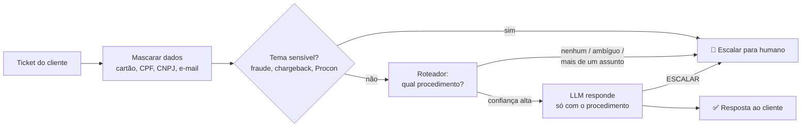

# 🤖 Agente de IA para Suporte Financeiro


Agente que lê o ticket de um cliente, **identifica o procedimento financeiro certo**, responde com base nele e **escala para um humano** quando o caso é sensível ou ambíguo, sem nunca expor dados pessoais.

> **Sobre este repositório:** é uma **versão demonstrativa** de um projeto real que desenvolvo no meu trabalho, no atendimento financeiro de uma empresa de hospedagem.
> Empresa, procedimentos e tickets aqui são **100% fictícios** ("Acme Hosting"). Nenhum processo, macro ou dado interno real foi usado.

---

## 🎯 O problema

No atendimento financeiro N1, a maioria dos tickets se repete: reembolso, cobrança em duplicidade, cartão recusado, plano suspenso, boleto não compensado. No projeto real, percebi que a área **não tinha uma base estruturada de processos**: o conhecimento ficava na cabeça de quem atendia.

Sem base, um agente de IA não tem de onde tirar a resposta certa. Por isso a solução tem duas partes:

1. **Base de conhecimento**: cada procedimento escrito de forma que uma pessoa *e* uma IA consigam seguir.
2. **Agente**: usa essa base para responder sozinho o que é simples e entregar a uma pessoa o que é arriscado.

## 💡 Como funciona



| Etapa | Arquivo | O que faz |
|---|---|---|
| Base de conhecimento | `base_conhecimento/*.md` | 7 procedimentos com palavras-chave, regras de escalonamento e resposta modelo |
| Privacidade (LGPD) | `agente/privacidade.py` | Mascara cartão, CPF, CNPJ e e-mail **antes** de qualquer processamento |
| Guardrails | `agente/guardrails.py` | Fraude, chargeback, Procon, advogado → sempre humano, sem depender do modelo |
| Roteador | `agente/roteador.py` | Escolhe o procedimento, calcula confiança e detecta tickets com mais de um assunto |
| Respondedor | `agente/respondedor.py` | Com chave de API, o LLM responde **restrito ao procedimento**; sem chave, usa a resposta modelo (modo offline) |
| Orquestração | `agente/core.py` | Junta tudo e devolve a decisão: responder ou escalar, com o motivo |

## 🧠 Decisões de design

- **Escalar é um resultado válido, não uma falha.** Em suporte financeiro, responder errado custa mais do que passar para um humano. O erro mais grave medido é "respondeu quando devia escalar".
- **Regras críticas fora do LLM.** Fraude e risco jurídico são detectados por regra determinística: o modelo não tem chance de "esquecer".
- **O LLM só fala do que está no procedimento.** Se o procedimento não cobre o caso, ele responde `ESCALAR` em vez de inventar.
- **Dados pessoais nunca chegam ao modelo nem aos logs.** O mascaramento é a primeira etapa.
- **Respostas não prometem o que o agente não verificou.** Ex.: em vez de "identifiquei a duplicidade", o agente diz "vou verificar" e pede o número do pedido.

## 📊 Avaliação

`avaliar.py` roda o agente em 24 tickets fictícios (`dados/tickets_exemplo.csv`) com a decisão esperada:

```
Tickets avaliados ............ 24
Decisão correta (resp/escalar) 24/24 = 100%
Procedimento correto ......... 15/15 = 100%
Respondeu quando devia escalar 0
```

**Leitura honesta:** o conjunto é pequeno e foi usado durante o desenvolvimento, então esse 100% mede se as regras funcionam como projetadas, não o desempenho em produção. A primeira rodada deu **88%** e revelou 3 problemas reais, que foram corrigidos:

| Problema encontrado | Correção |
|---|---|
| A palavra-chave `nf` casava dentro de "co**nf**iguro" | Busca por palavra inteira |
| "Me arrependi" não era reconhecido como reembolso | Novas palavras-chave |
| Ticket com dois assuntos (boleto + cancelamento + reembolso) era respondido | Detecção de múltiplos assuntos → humano |

## ▶️ Como executar

```bash
# Modo offline (sem API, sem custo)
python -m agente "Fui cobrado duas vezes no cartão 4111 1111 1111 1111" --nome Ana
python avaliar.py
pytest -q

# Modo com LLM (opcional)
pip install -r requirements.txt
cp .env.example .env   # preencha ANTHROPIC_API_KEY — o .env nunca vai para o GitHub
```

Exemplo de saída:

```
Ação: RESPONDER | procedimento: cobranca-duplicada | confiança: 1.0
Resposta:
Olá, Ana! Vou verificar as transações do seu pedido. Se a duplicidade se confirmar,
o valor extra é estornado e aparece em até 2 faturas do cartão. Pode me informar o
número do pedido? (Não precisa enviar o número do cartão.)
```

## 🚀 Próximos passos

- [ ] Conjunto de avaliação separado (tickets nunca vistos durante o desenvolvimento)
- [ ] Roteamento semântico com embeddings, mantendo as palavras-chave como reserva
- [ ] Versão em n8n integrada a uma ferramenta de tickets
- [ ] Painel com taxa de resolução automática e motivos de escalonamento

---

**Autor:** Felipe Kimura · [LinkedIn](https://linkedin.com/in/felipe-kimura)
